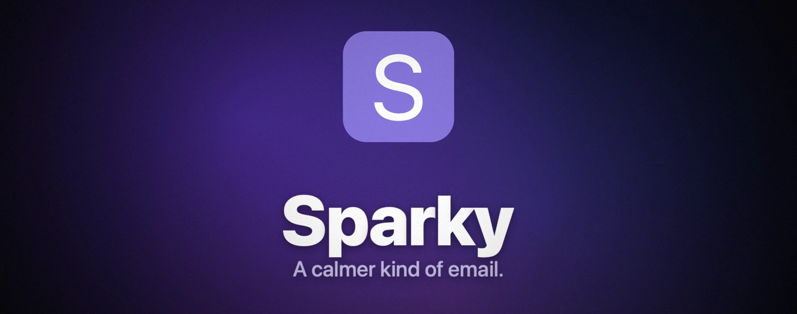
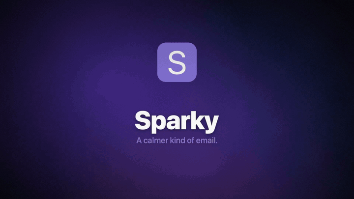
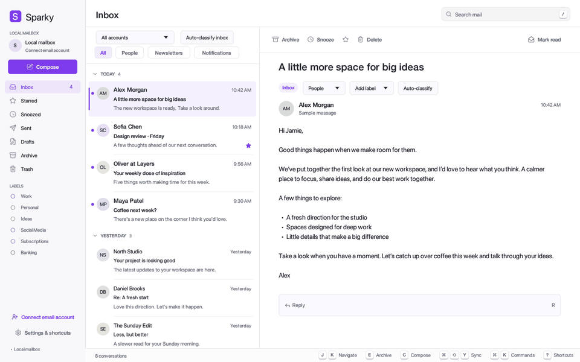
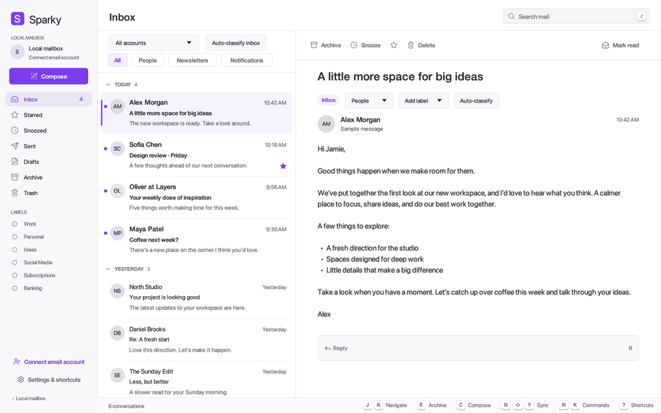
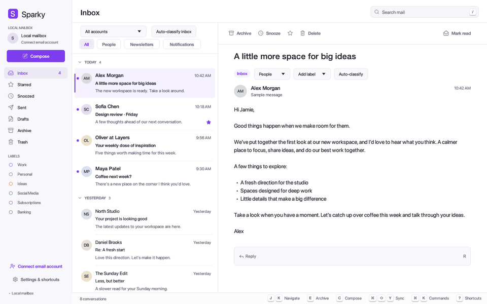
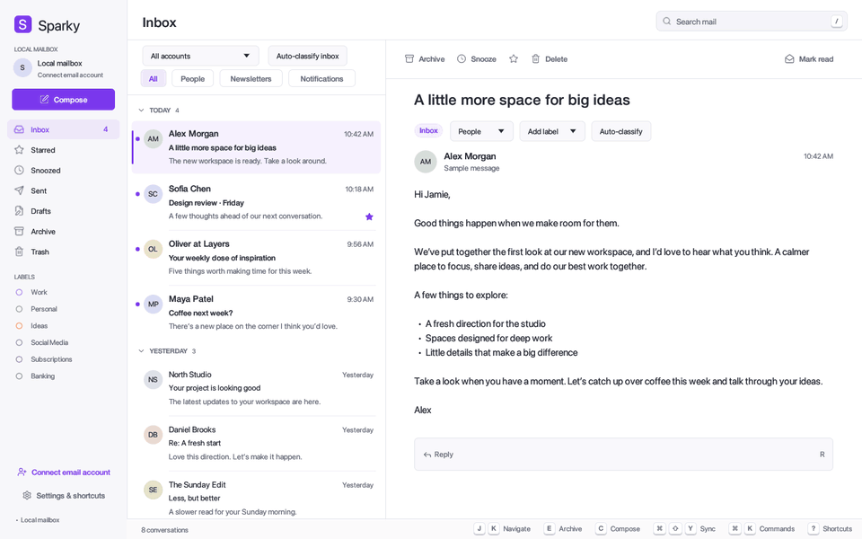
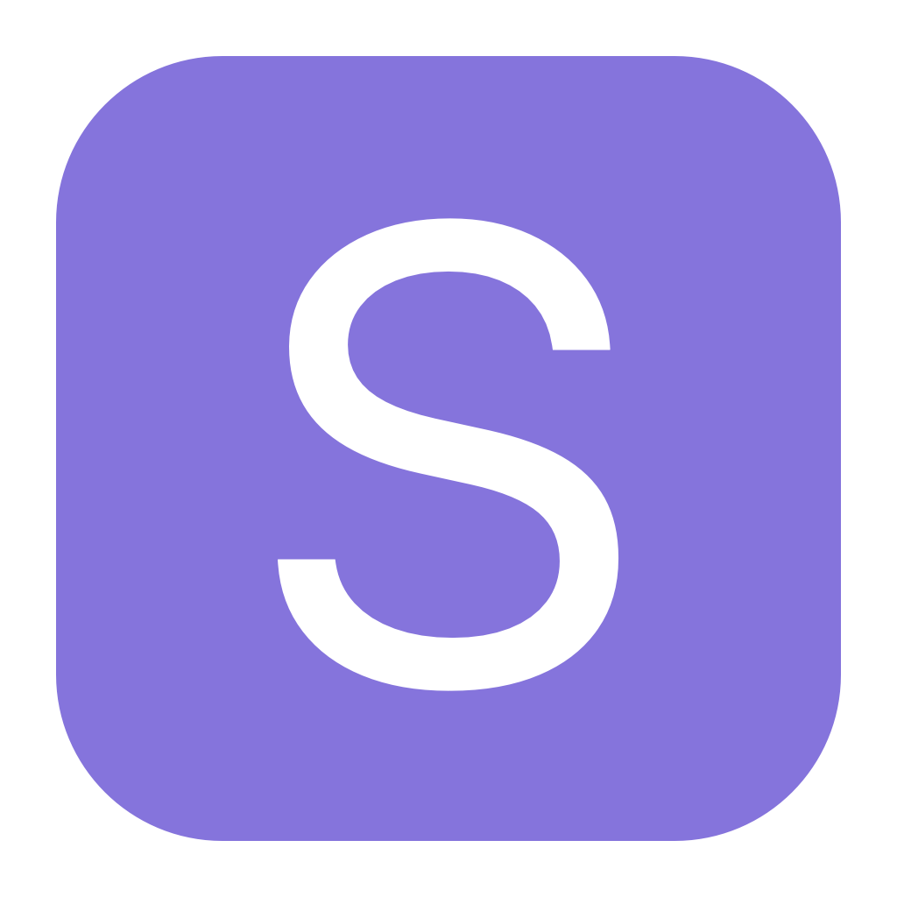

<div align="center">



<h3>I got fed up with email clients. So I built my own — over a weekend.</h3>

<p>
A native, keyboard-first mail client for macOS, written in pure Rust.<br>
Inspired by Superhuman and Spark. On-device AI. Only the features I actually want.
</p>

<p>


</p>

<a href="docs/media/sparky-promo.mp4">
  
</a>

<sub>▶ <a href="docs/media/sparky-promo.mp4"><b>Watch the 36-second promo</b></a> — every animation in it is the real app, recorded frame by frame.</sub>

<br><br>

<a href="#-features">Features</a> ·
<a href="#%EF%B8%8F-keyboard-first">Keyboard</a> ·
<a href="#-ai-that-stays-on-your-mac">AI</a> ·
<a href="#-privacy">Privacy</a> ·
<a href="#-get-started">Get started</a> ·
<a href="docs/google-setup.md">Gmail setup</a> ·
<a href="#-under-the-hood">Under the hood</a> ·
<a href="#-credits">Credits</a>

</div>

---

## ✨ Why Sparky?

Every mail client I tried was either slow, bloated, subscription-locked, or shipped my inbox to someone's server for "smart" features. So I wrote the one I wanted:

<table>
<tr>
<td width="25%" valign="top">

### ⚡ Instant
Native Rust + egui. No Electron, no web view. A ~4 MB app that opens before you finish blinking.

</td>
<td width="25%" valign="top">

### ⌨️ Keyboard-first
Every action has a key. `⌘K` runs anything, `/` searches everything, `J` `K` `E` clears your inbox.

</td>
<td width="25%" valign="top">

### 🧠 AI that stays home
Auto-labelling runs **on your Mac** with Apple's Foundation Model. Or bring Ollama / your own server.

</td>
<td width="25%" valign="top">

### 🔒 Yours
Mail lives in a local SQLite file. Credentials live in the macOS Keychain. No telemetry. No account.

</td>
</tr>
</table>

---

## 🎬 Features

<table>
<tr>
<td width="50%" valign="top">

### Command palette — `⌘K`
VS Code-style fuzzy matching. Type `gti` → **Go to Inbox**. Matched letters light up, recent commands float to the top, and anything that can't run right now tells you why.



</td>
<td width="50%" valign="top">

### Search everything — `/`
Algolia-style instant search across every folder, powered by SQLite FTS5. Results grouped by folder with highlighted excerpts. Enter jumps straight to the mail.



</td>
</tr>
<tr>
<td width="50%" valign="top">

### Swipe. Gone.
Two-finger swipe or drag to reveal **Archive** and **Delete**, with a critically damped spring, rubber-band resistance and a row that slides out and collapses. `E` and `#` get the exact same animation.



</td>
<td width="50%" valign="top">

### Inbox zero at keyboard speed
`J` / `K` glide the selection, `E` archives, `G` then `I` jumps to Inbox. Superhuman muscle memory, zero subscription.



</td>
</tr>
<tr>
<td width="50%" valign="top">

### Every shortcut, searchable — `⌘/`
Search by name, filter by group, or hit **Record keys** and press any key to see what it does.


</td>
<td width="50%" valign="top">

### Make it yours
Six accessible accent themes (all WCAG-checked in tests), crisp Lucide icons, SF Pro typography and a reading pane tuned for long-form mail.


</td>
</tr>
</table>

### And also…

- 📬 **Unified inbox** for **Gmail** (Google sign-in with PKCE), **Outlook / Microsoft 365** (Graph) and any **IMAP/SMTP** account, with an account filter that follows you everywhere.
- 🧵 **Real threading** from Gmail thread IDs, Graph conversation IDs and the `Message-ID` / `References` graph — never merged by subject alone.
- ✍️ **Native rich editor** for compose and inline replies: bold, italic, underline, headings, code, lists, quotes. Sent as HTML with a plain-text alternative.
- 🗂️ **Smart splits**: People · Newsletters · Notifications, plus labels for Work, Personal, Ideas, Social Media, Subscriptions and Banking.
- 💤 **Snooze, star, unread, drafts** — all local, all instant.
- 📅 **Date sections** (Today, Yesterday, Earlier) with sticky headers.

---

## ⌨️ Keyboard-first

<div align="center">

| Keys | Action | | Keys | Action |
|:---:|---|---|:---:|---|
| <kbd>⌘</kbd> <kbd>K</kbd> | Command palette | | <kbd>J</kbd> / <kbd>K</kbd> | Next / previous |
| <kbd>/</kbd> | Search all mail | | <kbd>E</kbd> | Archive |
| <kbd>⌘</kbd> <kbd>/</kbd> or <kbd>?</kbd> | Shortcut guide | | <kbd>#</kbd> | Delete |
| <kbd>C</kbd> | Compose | | <kbd>S</kbd> | Star |
| <kbd>R</kbd> | Reply | | <kbd>H</kbd> | Snooze 24 h |
| <kbd>⌘</kbd> <kbd>↵</kbd> | Send | | <kbd>U</kbd> | Toggle unread |
| <kbd>G</kbd> → <kbd>I</kbd> <kbd>S</kbd> <kbd>T</kbd> <kbd>D</kbd> <kbd>A</kbd> | Go to Inbox, Starred, Sent… | | <kbd>1</kbd>–<kbd>4</kbd> | Switch split |
| <kbd>⌘</kbd> <kbd>⇧</kbd> <kbd>Y</kbd> | Sync all accounts | | <kbd>⌘</kbd> <kbd>,</kbd> | Settings |

</div>

Every binding, label, tooltip and guide entry comes from a single catalog in [`app/src/shortcuts.rs`](app/src/shortcuts.rs).

---

## 🧠 AI that stays on your Mac

Sparky sorts and labels mail with a model **you** choose — and never silently falls back to another one:

| Provider | Where it runs |
|---|---|
| 🍎 **Apple Foundation Model** *(default)* | On-device, via a tiny Swift bridge. macOS 26+ with Apple Intelligence. |
| 🦙 **Ollama** | A local model on this Mac. |
| 🛠️ **Your own server** | Any OpenAI-compatible API (MLX, vLLM, …). |

- **Instant rules first.** Obvious senders never touch a model: LinkedIn, X and Facebook go to *Notifications + Social Media*, Product Hunt and Medium to *Newsletters + Social Media*, and your banks to *Banking*.
- **Learns from you.** Fix a label once and that correction becomes a few-shot example for similar mail. Nothing is retrained and nothing leaves your machine (unless you pointed it at a remote server).
- **Confident or it asks.** Below 75% confidence nothing changes; you get an editable suggestion to accept or dismiss.

---

## 🔒 Privacy

- **Local first.** Mail is stored in SQLite (WAL + FTS5) on your Mac. Folder moves, stars, snoozes and labels stay local.
- **Keychain only.** OAuth refresh tokens and app passwords live in the macOS Keychain — never in the database, the app bundle, logs or command-line arguments.
- **No telemetry, no backend, no account.** Sparky talks only to your mail provider and the AI provider you picked.
- **No secrets in this repo.** Google sign-in needs *your own* Desktop OAuth client ([10-minute setup guide](docs/google-setup.md)).

---

## 🚀 Get started

> [!IMPORTANT]
> Sparky is an **early alpha** built in a weekend. It's my daily driver, but expect rough edges — see [what's not done yet](#%EF%B8%8F-roadmap).

### 1 · Download

<p align="center">
  <a href="https://github.com/MohamedAlaa/sparky/releases/latest/download/Sparky.dmg">
    
  </a>
  <br>
  <sub>macOS 11+ · Apple silicon · ~4 MB · <a href="https://github.com/MohamedAlaa/sparky/releases">all releases</a></sub>
</p>

Open **Sparky.dmg** and drag **Sparky** onto **Applications**.

### 2 · First launch

Sparky isn't notarized by Apple yet, so macOS asks once:

1. Open Sparky from Applications. macOS says it *can't verify* the app — click **Done**.
2. Go to **System Settings → Privacy & Security**, scroll down to *"Sparky was blocked…"* and click **Open Anyway**, then confirm.

<details>
<summary>Prefer Terminal?</summary>

```bash
xattr -dr com.apple.quarantine /Applications/Sparky.app
```

</details>

It opens with a demo mailbox, so you can try every shortcut right away.

### 3 · Connect your mail

Click **Connect email account**:

- **Gmail** — Sparky signs in with **your own** free Google Cloud client, so your mail never passes through anyone else's servers. One-time setup, about 10 minutes: enable the Gmail API, add yourself as a **test user**, create a Desktop OAuth client, paste its JSON into Sparky, then **Continue with Google**.
  👉 **[Step-by-step Google setup guide](docs/google-setup.md)** (the app links to it too).
- **IMAP/SMTP** — your address, an app password and your TLS hosts. Works instantly.
- **Outlook / Microsoft 365** — address plus a Graph access token (browser sign-in coming).

Accounts are saved in your macOS Keychain and stay connected.

### Build from source

**Requirements:** macOS, [Rust](https://rustup.rs) stable, and Xcode command line tools (`xcode-select --install`).

```bash
git clone https://github.com/MohamedAlaa/sparky.git
cd sparky/app
cargo run --release          # a clean demo mailbox lives in app/demo/
cargo test                   # never touches your real Keychain or mailbox
./scripts/make-dmg.sh        # build your own Sparky.dmg
```

---

## 🔧 Under the hood

```
app/
├── src/
│   ├── main.rs         UI: panes, list, swipe physics, modals, palette, search
│   ├── storage.rs      SQLite via raw FFI — WAL, mmap, FTS5, atomic index updates
│   ├── sync.rs         Gmail REST · Microsoft Graph · IMAP/SMTP adapters
│   ├── oauth.rs        Google desktop OAuth: PKCE S256, loopback callback
│   ├── credentials.rs  macOS Keychain
│   ├── classifier.rs   sender rules + LLM classification + learning from corrections
│   ├── threading.rs    Message-ID / References conversation graph
│   ├── shortcuts.rs    the one keyboard catalog + fuzzy matcher
│   ├── editor.rs       native rich-text editor
│   ├── icons.rs        Lucide SVG icons + motion helpers
│   ├── recorder.rs     frame-accurate scripted recordings (made the promo!)
│   └── theme.rs        accent themes with contrast tests
└── native/FoundationModel.swift   on-device Apple model bridge
```

- **Pure Rust UI** on [egui](https://github.com/emilk/egui) / eframe, painter-driven for pixel-level control.
- **Tiny dependency tree**: eframe, egui_extras, image, serde, base64, url. SQLite is the one macOS ships.
- **Deterministic animation recording**: `cargo run -- --record <dir> <script>` drives the real UI with simulated time at 60 fps. The promo was composited from those frames with a CoreImage 3D renderer and a soundtrack synthesized in Swift — see [`promo/`](promo/README.md).

---

## 🗺️ Roadmap

- [ ] Attachments
- [ ] Remote writeback (archive / delete / flags on the server)
- [ ] Incremental + background sync
- [ ] Microsoft browser sign-in
- [ ] Full MIME and international charset decoding for IMAP
- [ ] Signed and notarized releases
- [ ] Linux and Windows builds

Contributions, ideas and bug reports are very welcome — open an issue or a PR.

---

## 🙏 Credits

<table>
<tr>
<td width="90" align="center">🛠️</td>
<td>

**Built with [Craft Anything](https://github.com/storytold/craft-anything)** — *understand how any software works, and craft your own.*
Sparky went from "I want my own mail client, part Spark, part Superhuman" to a working native app over a weekend with Craft Anything. Huge thanks to the [ArtCraft](https://getartcraft.com/apps/craft-anything) team for making it.

</td>
</tr>
</table>

- Icons: [Lucide](https://lucide.dev) (ISC) — see [`app/assets/icons/LICENSE-lucide`](app/assets/icons/LICENSE-lucide).
- UI: [egui](https://github.com/emilk/egui) by Emil Ernerfeldt and contributors.
- Inspiration: Superhuman and Spark. Sparky is an independent project and is not affiliated with either.

---

## 📄 License

Licensed under either of [MIT](LICENSE-MIT) or [Apache-2.0](LICENSE-APACHE), at your option.

<div align="center">
<br>

<br>
<sub>Made with ⚡ and a little impatience over a weekend.</sub>
</div>
